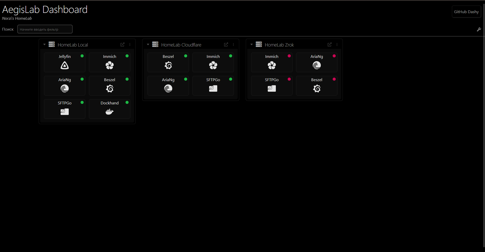
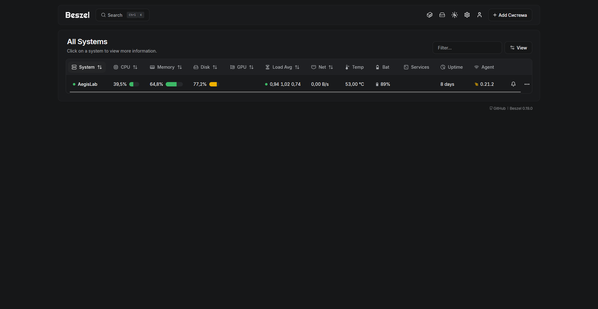
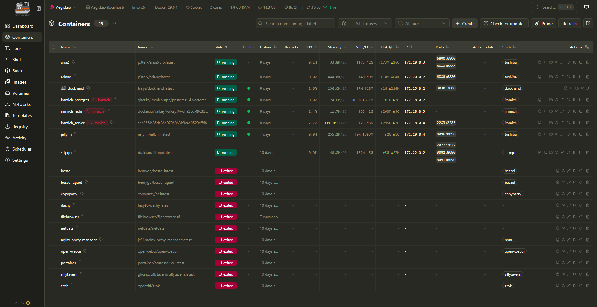
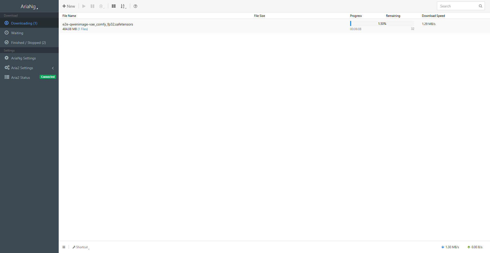
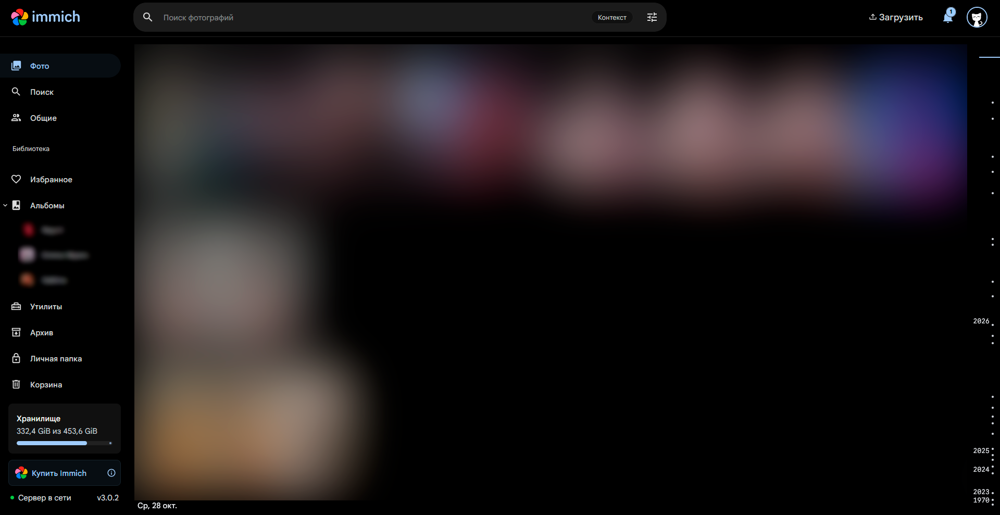
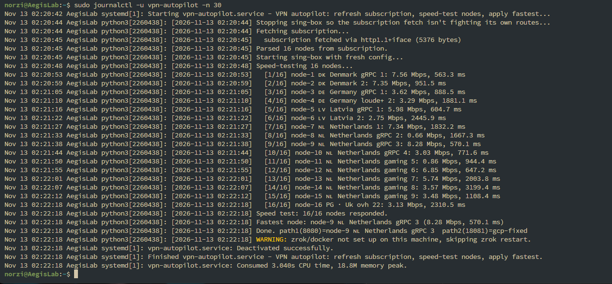
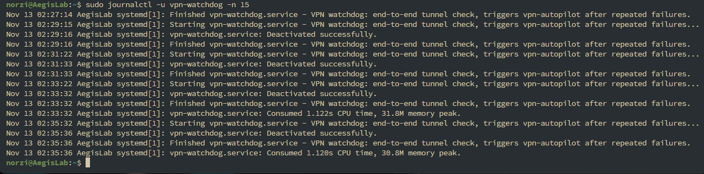

# AegisLab: a self-hosted homelab on two old laptops

A Debian homelab built from scratch on e-waste hardware, on a home connection hard-capped by the ISP at 6 Mbit/s, where GitHub, Linux package mirrors and many other services are blocked by the ISP. It runs media, photos, downloads, file sharing and monitoring, and is reachable from anywhere through a tunnel.

I built it at 17-18 with no prior Linux, Docker or networking experience. There were no ready-made guides for my network conditions, so I learned by asking questions, checking answers against each other and debugging my own mistakes.

## Hardware

| Stage | Machine | Specs |
|---|---|---|
| Initial build | Toshiba Satellite L500-1RW | Intel Core i3-330M, 4 GB RAM, 500 GB HDD |
| Current server | Lenovo E10-30 | 2 GB RAM, weak CPU, 500 GB HDD moved over from the Toshiba (replacing the original 320 GB drive) |

The Toshiba became unreliable (it often failed to boot and shut down at random), so I moved the drive to the Lenovo, shut down the heavy containers and kept only the essential ones. Everything still fits and runs well in 2 GB of RAM.

Measured on the Lenovo (Beszel and Dockhand screenshots below): about 1.2 GB of the 1.8 GB usable RAM in use for the whole system, roughly 0.9 GB of that is the containers (Immich server 399 MB, Jellyfin 255 MB, Dockhand 136 MB, SFTPGo 41 MB, aria2 34 MB, Postgres 25 MB, Redis 12 MB). CPU around 40%, 53 °C, 8 days of uptime.

## Software and services

- **OS:** Debian 13 (Trixie), minimal CLI-only install, managed over SSH (Termius)
- **Containers:** Docker + Compose, managed with Dockhand (replaced Portainer for better usability)
- **Media:** Jellyfin
- **Photos:** Immich
- **Downloads:** aria2 + AriaNg web UI (the only way to download heavy files 24/7 on a slow link)
- **File access:** SFTPGo (first File Browser, then switched for SFTP integration)
- **Dashboard:** Dashy, so I only need to remember one port. Three groups of links (local, via Cloudflare, via zrok) with live status dots
- **Monitoring:** Beszel for everyday overview, Netdata kept installed for detailed real-time inspection when needed
- **Local AI frontend:** Open WebUI (backend runs separately on my main PC, see the local-ai repo)
- **Network and VPN client:** sing-box
- **Remote access:** Cloudflare Tunnel (cloudflared) with Nginx as reverse proxy, every service behind a password

### Trimming heavy services for weak hardware

Jellyfin and Immich are both heavy by default. I asked what exactly eats resources: transcoding in Jellyfin, machine learning in Immich. I disabled transcoding, removed the Immich machine-learning container and capped the Immich server at 712 MB of RAM (`mem_limit`). The services run fine on a 2 GB machine.

## Architecture

```
Phone / PC (VPN on)
        |
   Cloudflare (own domain)
        |
   cloudflared tunnel  <--- sing-box TUN keeps the path to Cloudflare open
        |
   Nginx reverse proxy (one hostname per service, password-protected)
        |
   Docker containers: Jellyfin, Immich, SFTPGo, AriaNg, Dockhand ...
```

## Screenshots

Personal photos and media titles are blurred.

**Dashy: one entry point to every service, with live status** (the Cloudflare group is green, so the tunnel works end to end)



**Beszel: system overview of the Lenovo** (CPU, memory, disk, temperature, battery)



**Dockhand: all containers, memory limits and stacks.** Exited containers are services I tried and stopped (Portainer, File Browser, Netdata, Nginx Proxy Manager, zrok and others); only the essentials stay running on the 2 GB machine.



**aria2 + AriaNg: a download in progress, 1.3 MB/s (about 10 Mbit/s) on a line capped at 6 Mbit/s.** How that works is covered in the [multipath write-up](https://github.com/Norzi/aegisnet/tree/main/multipath) ("6+6").



**Immich and Jellyfin**




## Problems I had to solve

### 1. Installing Debian without the internet I needed
The normal network installer was unusable because repositories are blocked. I used an offline installer and a minimal CLI image, since the lightest possible system was the goal.

### 2. Getting the first packages
`apt` and `curl` do not reach blocked mirrors, and I needed sing-box to get a VPN working in the first place. Workaround: I shared a VPN connection from my phone over the local network (proxy sharing), pointed Debian's environment at that proxy, and downloaded sing-box through it. Then I configured sing-box properly.

### 3. Locking myself out with TUN mode
My first TUN configuration did not bypass the local network, so SSH dropped immediately and I had to fix it physically on the laptop. Lesson learned: route LAN traffic outside the tunnel before enabling TUN. Related early setting: keeping the laptop running with the lid closed (logind lid-switch config).

### 4. Remote access when Tailscale is blocked
- Tailscale: blocked, dropped.
- zrok: works, but needed a lot of troubleshooting.
- **Cloudflare Tunnel: chosen.** I already had a free domain on Cloudflare. Cloudflare itself is blocked locally, so both the server and my phone need a VPN to reach it. I set up Nginx by hand (before I knew Nginx Proxy Manager existed), exposed each service step by step and put a password on everything. I later tried Nginx Proxy Manager, but kept the plain Nginx: it works, I am not adding new services (there is little free disk space left), and a web UI on top would only cost RAM on a 2 GB machine.

### 5. VPN configs that die overnight
Free and subscription VPN configs get blocked quickly. I solved it in stages:

1. **Manual scripts:** update the subscription, run a speed test, pick a node by hand. The speed test downloads a 5-10 MB file and reports real throughput in Mbit/s instead of just ping.
2. **Automatic script** combining all three steps, run by a `systemd` timer every 90 minutes.
3. **Watchdog** that checks every 2 minutes whether traffic really flows through the active node (a real HTTPS request through the tunnel, not a ping), and triggers the update script after 3 failures in a row. This closed the gap where a node could die inside the 90-minute window.

The final code is in [`scripts/`](scripts/) with its own README. It includes rollback to the last working config, a lock file so two runs never overlap, and a cooldown against restart loops.

Autopilot run: fetches the subscription, speed-tests all 16 nodes with real downloads and picks the fastest one (journal output):



Watchdog running every 2 minutes in the background:



## Skills I practiced

Linux administration (users, `sudo`, `systemd` timers, networking), Docker and Compose, reverse proxying, tunnels, VPN client routing (sing-box), shell scripting, monitoring, and resource-limited deployment. Also reading logs and reasoning about errors instead of copying commands.

## How I worked

I used several AI assistants and picked each by strength: one for scripts and accurate technical answers, one for web search with fewer hallucinations, one for basic Linux questions. I did not copy answers blindly. At first I pasted Compose files, then I asked what every line does. When an answer looked wrong, I compared with other assistants and argued my own proposals. In my network conditions, copying without understanding simply does not work.

The core setup took about a week. After that I kept extending and fixing it, so I cannot give an exact "learning time": it never stops.

## Repository layout

```
aegislab/
  README.md
  docs/img/        # screenshots
  compose/         # sanitized docker-compose files, one folder per service (see compose/README.md)
  scripts/         # vpn_autopilot.py, vpn_watchdog.py, systemd units (see scripts/README.md)
```

> All IPs, domains, tokens, subscription links and passwords are removed or replaced with placeholders.
